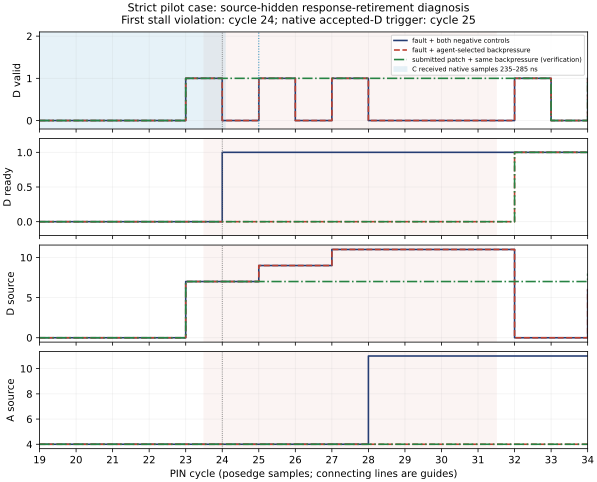

# TileLink causal debugging: observation, intervention and verified repair

**Showcase-only continuation complete under an explicit user waiver of human review; primary comparison NOT_RUN.** This study demonstrates a source-hidden diagnosis followed by a real predicted intervention, two separate negative controls, and a model-submitted repair verified with an independent oracle and a second simulator. All 52 strict pilot subjects finished: 39 completed with runtime-verified repairs and 13 failed the tool quota. These pilot outcomes do not estimate an accuracy benefit from native observation or intervention. Expert mechanism and prediction grading was not performed; human review was waived for showcases.

Execution used `gpt-6.1-sol`, `medium`, as explicitly authorized by the user's model change. Every subject passed `account/read=chatgpt` and exact `model/list` availability through local Codex app-server. The service reports plan type `prolite`; we preserve that label without reinterpreting it. No API-key authentication, separately billed API client, OpenAI Python SDK, alternative model, or API-only prompt-cache configuration was used. The accepted abstract was not edited.

Evidence paths beginning `results/`, `.deps/`, `protocol/`, `agents/` or `tools/` are relative to **`attempts/sol_medium_restart_001`** inside this isolated V7 project. Linked figures and receipts are sanitized paper artifacts. Earlier DVCon projects and all original failed runs are preserved.

## A source-hidden causal case

The endpoint implements a bounded, single-beat TileLink-UL A/D profile with banked memory, masked writes, multiple outstanding sources, reuse after retirement, response reordering and backpressure. The public contract requires a stalled D response to retain valid and payload until acceptance. This case concerns premature response retirement.

At cycle 6, the accepted A request uses source 7, address 80 and write data 1749090055. At cycle 23, its WriteAck is offered with `d_valid=1`, `d_ready=0`, `d_source=7`. At cycle 24, valid falls without a handshake: the independent oracle's first `d_stall_payload_instability` violation. The first accepted D transfer is source 9 at cycle 25, corresponding to the native trigger at 295000 ps.

The native observer retained sampled history before that trigger. A fresh **C subject** actually queried records spanning 235000–285000 ps and received `d_valid` rising at 275000 ps and falling at 285000 ps. Its value evidence showed `pending[7]` clearing while the response was unaccepted. Before seeing source, it described premature clearing/retirement, retained arbitration withdrawal and a sampling discrepancy as alternatives, and explicitly left exact RTL causation unverified. Its sealed assessment cites issued PIN/native/value evidence; SHA256: `feba4c4552678c5c4a9de0e9e2a45d97806e35fefff269eba906a839f996ea59`.

A separate fresh **D subject** identified a response-clear/retire path that did not require `d_valid && d_ready`. It received only the initial native context at 235000–245000 ps; it did **not** receive C's later valid transition. Its final citations are PIN, value and experiment evidence. C and D shared no conversation or answers. Thus the native pretrigger record is an observed C capability, not evidence that native observation caused D's diagnosis.

Before the host executed any experiment, D selected `response_backpressure`, counter 23, duration 8, and predicted that source 7 would lose valid before acceptance under continuous stall, whereas correct retention would hold source and valid until release. It predicted that an unrelated inert-net force and an idempotent request-throttle-zero force would reproduce the baseline failure. These predictions were submitted in the experiment request before execution; expert discrimination scoring was not performed under the showcase waiver.

| Executed condition | Force/release markers | Independent oracle | Observed contrast |
|---|---|---|---|
| Fault baseline | Baseline run | FAIL, 12 issues | First stalled-D violation at cycle 24 |
| Selected response backpressure | Both present | FAIL, 11 issues | Valid still withdraws; first additional non-target difference is A-channel state at cycle 28 |
| Independent inert-net negative control | Both present | FAIL, 12 issues | Public trace identical to baseline |
| Independent idempotent negative control | Both present | FAIL, 12 issues | Public trace identical to baseline |

The force begins at negedge counter 23 **between PIN samples 23 and 24**, and releases at counter 31 **between samples 31 and 32**. The model's request described cycles 23–30; this report uses actual marker/sample alignment. The lower issue count under intervention is not a repair or an effectiveness benefit. The experiment distinguishes withdrawal from compliant retention under held backpressure, but does not uniquely distinguish every internal mechanism. Cross-simulator agreement further weakens a simulator-specific sampling explanation.

D then sealed its source-hidden mechanism, alternatives, prediction and valid issued evidence IDs, SHA256 `fb6c67e4f15074d8bd4bdfd5bd41581d8c641bf36fef3f13444a066fc538f707`. The seal was fsynced and made readonly **before** the permitted faulty endpoint source was disclosed for Stage II. The real model submission added the handshake guard:

```diff
-if (d_valid) begin
+if (d_valid && d_ready) begin
   pending[d_source] <= 0;
   d_valid <= 0;
 end
```

The submitted source SHA256 is `6cbb5c1a4b660d8172e377020fa602f39561b8e1f830118d60544cb3f1bb9771`. A separate grader compiled it and passed original, unseen and adversarial schedules. Post-submission reference-simulator replay of those exact schedules also passed, with public traces matching the research simulator. Reference replay reproduced all four faulty intervention traces. Applying the same registered experiment to the actual patch on both simulators produced **eight passing oracle runs**, matching cross-simulator public traces and unchanged negative controls. Source 7 and valid remain stable at samples 23–32, with acceptance when ready returns at sample 32. This is independent executable verification; human semantic review was waived for showcases.



**Figure 1.** Actual sampled traces: faulty baseline plus both negative controls, faulty selected intervention, and the submitted repair under the same intervention. The native shading identifies records received by the separate C subject; it does not imply D saw those records. Connecting lines guide the eye between posedge samples. [Vector PDF](figures/strict_case02_timeline.pdf), [plot data and trace hashes](figures/strict_case02_timeline_data.json), [sanitized case receipt](receipts/strict_case02_D.json).

Two supplemental recorded cases preserve an incorrect monitor alarm-timing prediction and a scoreboard intervention that initially ran too late. Their subsequent repairs passed three schedules on both simulators and anti-silencing canaries; all registered faulty control traces reproduced independently. See the [three-showcase catalog](SHOWCASE_CATALOG.md) for actual predictions, controls, misses and patch receipts.

## Pilot outcomes and costs

A provides public pins/VCD; B adds value/writer trace; C adds qualified native samples; D adds agent-selected force/release and two executed controls. The uniform schedule contains five named and eight temporal **pilot-only** constructs, four modes and one repetition: 52 subjects. Temporal constructs include endpoint, traffic-adapter, monitor and scoreboard faults. All named cells repaired; temporal cells produced 19 repairs and 13 quota failures. These exposed constructs are ineligible for primary holdouts.

Each subject used a fresh Codex subprocess and `thread/start`: 52 distinct processes and 52 distinct threads, no resume/fork. Every observed model-facing tool specification matched the case-only allowlist. The only dynamic calls were 471 `read_evidence` and 16 `run_controlled_experiment` requests. A/B/C expose only the former; D exposes both. Empty model workspaces, stripped inherited credentials/session identifiers, restricted runtime roots, disabled shell/web/MCP/delegation surfaces and denied outside-file/symlink/write/network probes were checked. Raw tool exchange and model responses remain private. This is tested capability configuration, not a formal OS isolation proof.

| Mode | Scheduled | Verified repairs | Quota failures | Median subject wall, s (range) | Reported input tokens | Output tokens | Cached input tokens |
|---|---:|---:|---:|---|---:|---:|---:|
| A | 13 | 12 | 1 | 29.85 (22.42–69.25) | 1,866,088 | 12,114 | 1,513,344 |
| B | 13 | 9 | 4 | 37.07 (30.89–49.42) | 2,380,282 | 13,087 | 2,015,872 |
| C | 13 | 8 | 5 | 45.88 (24.68–61.83) | 2,791,207 | 13,316 | 2,424,960 |
| D | 13 | 10 | 3 | 47.10 (35.59–63.90) | 2,769,231 | 16,939 | 2,331,648 |

Input counts include provider-reported cached input; cached tokens are not added a second time. All 52 subjects reported token/cache telemetry; unknown counts are zero **for this cohort**, not a general assumption. Nonzero cache reads never exclude a trial. Fresh threads do not erase pretraining, eliminate provider caching or pin immutable model weights. Subscription-dollar allocation and remote inference hardware/RSS are unknown; token totals are service telemetry, not a separate API invoice.

| Mode | Actual tool requests | Returned tool text, bytes | Native-query subjects | Qualifying-intervention subjects | Grading simulations / wall, s |
|---|---:|---:|---:|---:|---|
| A | 91 | 259,661 | 0/13 | 0/13 | 39 / 0.530 |
| B | 123 | 361,526 | 0/13 | 0/13 | 29 / 0.352 |
| C | 139 | 493,427 | 13/13 | 0/13 | 26 / 0.317 |
| D | 134 | 451,427 | 13/13 | 11/13 | 33 / 0.398 |

D issued 14 physical experiment requests: 12 met mechanical contrast/control requirements; two had valid markers and matching negatives but no non-target difference. Those unsuccessful experiments remain recorded; later selections stayed within the common experiment allowance. Sixteen intervention RPCs include two nonphysical/denied requests. The 56 actual incremental D simulations consumed 0.802 s invocation wall in total. Eleven D subjects executed a qualifying intervention; one of those later failed its quota, leaving ten completed D repairs. No mechanically passing experiment is counted as an expert-approved causal prediction.

All subjects shared 13 prerecorded case bundles (0.378 s capture invocation wall); this shared setup cannot be treated as a measured per-mode end-to-end capture comparison. Grading counts include anti-bypass canaries where applicable. Subject wall covers inference and case tools; grading and later independent showcase verification are separate. [All per-subject outcomes, costs and audit](receipts/strict_pilots.json).

**Calibration limitation and correction.** The host enforced 12 actions, 131072 bytes and 1200 seconds, but the pilot prose omitted the numeric quotas, and Codex conversion omitted schema numeric bounds. Thirteen subjects attempted a thirteenth permitted tool call; it was denied, and no Stage II source was disclosed or seal fabricated. This briefing defect makes comparative interpretation of quota-limited results inappropriate. All 52 used the same code snapshot (`4e1d375180b1763c7fcad73d1cf87fb01cf780b73bffd5b9b7a46e3bff46b15e`); no failed cell was retried or replaced. The snapshot was preserved after execution, not misrepresented as preregistration.

After all 52 finished, common prose/tool descriptions were corrected to state every bound and mandatory action. Response serialization now matches compact JSON evidence accounting. All 20 offline tests passed, and a fresh subscription-backed helper made one real pin query, recalled all ten numeric bounds and cited a valid issued ID. It is a briefing qualification, not another debugging subject or demonstrated outcome improvement. Wire audit of the original 52 found a maximum 48804 returned text bytes per subject, below 131072. [Calibration findings](CALIBRATION_FINDINGS.md), [briefing qualification](receipts/budget_briefing_qualification.json).

## Simulator, checker and native admission

Stock Xezim `80f00d354fc68c436569b12b6d4e175ef105a652`, paired core `837725742ba9aaa3b3408f770b288cf85f020ef9`, and the independent reference simulator pinned at `7786fb67c30faf197689b3bc3369c828e59c8ae7` passed original, unseen and zero-data schedules with identical recorded PIN/completion traces. Original traffic witnesses are 96 accepted A and 96 accepted D transfers, 16 maximum outstanding sources, 16 reused IDs, 25 partial writes, 3 zero-data writes, 132 D-stall samples and 202 response-order inversions. Five corrupted-trace controls and an executable byte-lane mutant were rejected. Fault injection yielding an oracle failure is expected admission evidence, not an invalid checker.

The separate opt-in native observer port derives from published commit `a2e29b76262ce3862759a93e1fe9a8341275c397`. Enabled/disabled public traces match stock. Qualification covers X/Z, 64 pretrigger/32 posttrigger records, 74 independently matched sampled fields, bounded event/byte truncation and unresolved-watch rejection. Sample phase is `testbench_call`; writer/source/scheduler-region provenance is unavailable and explicitly null. The fixed early capture window may miss late faults. Native sampled records originate inside the simulator; host semantic joins and waveform normalization are external postprocessing.

The strict fresh model-generated declarative mapper achieved 288/288 accepted-response joins over three schedules, zero wrong joins, and four bounded controls for missing requests, duplicate IDs, same-cycle retire/reuse and incomplete pending responses. Trusted host code interprets model-selected rules. This is neither a native plugin ABI nor universal X/Z/missing-history handling. Clean/fault control qualification used both permitted targets and both simulators; extended temporal controls cover six case/target combinations with four actual runs per simulator.

### Matched recorder measurements

Twelve serial rotating runs (three per recorder) passed the oracle and reconstructed identical sampled histories for ten public fields at the same posedge coverage. Metadata and storage policies differ.

| Recorder | Median compile, ms | Median simulation phase, ms | Median invocation wall, ms | Median peak RSS, KiB | Recorder bytes |
|---|---:|---:|---:|---:|---:|
| None | 3.0 | 4.8 | 11.964 | 34516 | 0 |
| VCD | 2.9 | 5.6 | 12.096 | 36588 | 12858 |
| Value trace | 3.0 | 8.7 | 15.505 | 38540 | 87124 |
| Native | 3.0 | 13.0 | 20.061 | 34924 | 1490185 |

The native recorder is larger and slower on this small instrumented fixture. No speed, compression or diagnosis benefit follows. The three individual samples and dispersion are retained in [recording data](figures/matched_recorder_costs_data.json) and [cost figure](figures/matched_recorder_costs.svg). Raw recorder bytes differ from model-facing tool text bytes.

## Failures, exclusions and reproducibility

The earlier 20 stock-runner named pilots are uniformly **DEVELOPMENT_ONLY**, excluded from strict comparison: built-in utilities remained advertised despite flags. Nineteen had executable repairs; one D subject failed to obtain a non-target contrast. Their original outcomes are preserved, not pooled with the 52 strict subjects. The patched local Codex 0.166.0 installs an opt-in core tool policy and validates final advertised specifications before inference; binary/runtime hashes bind authorization to the qualified executable.

Other retained failures include the initial missing-status test, sandbox/AppArmor refusals, workspace-requirements transport failures fixed by retaining `default_permissions=dvcon_case`, build lock/cache/header/include failures, build attempt 005 ending with unknown cause, intentional termination of expensive attempt 006, and two live strict qualifications with an empty tool surface. The supported direct-only namespace configuration fixed the latter. Build 007 completed with a recorded final CLI `-C opt-level=0` override; model/effort were unchanged. A long-path packed stimulus argument broke an early positive grader run; staging `stimulus.hex` in the run directory fixed it. All failed receipts remain alongside subsequent successful checks. The monitor timing prediction and first scoreboard target prediction also missed their stated outcomes despite mechanical experiment passes; both are explicitly retained in the showcase catalog. The earlier calibration suite passed 20 tests with a Make clock-skew warning; the final base suite passed 41 tests; that warning is recorded and is not a failed test or a new simulator build. [Failure ledger](receipts/failure_ledger.json), [runtime source/build identity](receipts/strict_runner_build.json), [tool audit](TOOL_SURFACE_AUDIT.md).

Runtime SHA256: `d1e71993c2faa26252c3c46aa19ceb0f9051c95ee41219f7ae423a1b6a64baac`; stock simulator SHA256: `84c479c9e79579f21495b620087807a8928efd2daaa03a0a7b16f85649ae7d8b`; research simulator SHA256: `690ce40f8f90c4971619e99b9de9c0cb95f10ef16416e85f1b6a1c5c47038341`. Build receipts retain local lock normalization and package identities. Public artifacts contain hashes, aggregate outcomes and selected pilot evidence, not credentials, private holdout keys or complete model conversations. No public repository upload was performed.

To inspect/recompute existing receipts from the active attempt:

```sh
make test
.deps/codex_cli_strict/runtime/bin/codex login status
make pro-check
python3 tools/summarize_strict_pilots.py
.deps/figure_venv/bin/python paper/figures/generate_strict_case.py
```

These commands do not rerun or replace experimental subjects. Live qualification and simulator/trial entrypoints use create-once output directories; additional runs require new IDs. Full raw reproduction requires the local pinned dependencies and private run receipts. The service model identifier cannot reproduce immutable weights.

## Prospective replacement, freeze and admission checkpoint

Eight high-risk constructor candidates were replaced before any fault instance was generated. Artificial transport codecs, scalar width/endian changes, source-index aliases and a deferred-snapshot proposal were removed. The versioned earlier drafts remain preserved. The finalized constructor design contains six endpoint, four monitor and two scoreboard fault mechanisms, plus two clean controls; this constructor decision is not independent novelty certification.

A case-independent temporal traffic recipe exercises repeated payloads at different addresses, write/read/write/read lifetimes and legal noncontiguous masks. Before freeze, the revised clean design passed nine simulator executions (three schedules on stock/research/reference) and one native/value/VCD capture with identical public behavior. It also passed 24 control executions (two targets × three simulators × four conditions); two exposed endpoint canaries still triggered the clean checking components. Accepted-pin measurements show up to16 outstanding writes,14 outstanding reads,65–72 evictions of live-read references from a four-entry diagnostic history,64–68 cycles from accepted read to first response offer,15–21 noncontiguous partial writes and32 repeated payloads at different addresses. These are measured clean opportunities, not inferred model outcomes or guarantees that an intervention prediction will discriminate mechanisms.

The actual prospective freeze occurred at **2026-10-31T03:10:12.668703+00:00**, before holdout generation. It binds81 source/protocol files, six protected private design inputs, binaries, locks and qualification artifacts. Freeze SHA256: `d30fd0a1002fdc519f2362f5eac114bae9b8708463c948a41f5994d1b7f6b075`. Timestamp scope is the local host clock with readonly/fsynced artifacts, not an external timestamp attestation or malicious-host protection. Fresh preflight confirmed ChatGPT authentication and exact `gpt-6.1-sol`/`medium` availability. No inference was performed by that preflight.

One post-freeze private generation produced twelve fault instances and two clean controls. All **252 actual automated admission runs** completed:108 expected independent-oracle fault rejections and144 expected clean passes. Every case/clean-counterpart/schedule public trace matched across the three simulators. A separate host process recomputed every saved oracle and checked hashes, with zero mismatches. These expected injected-fault rejections are successful admission evidence, not invalid-checker failures. The code/private-input freeze verifies unchanged after admission. All41 offline tests also pass after freeze, with a recorded Make clock-skew warning.

**Historical primary-study checkpoint, before the user waiver below.** Independent review was required by the unused primary protocol. Automated status is `PASS_AWAITING_REVIEW`, not approved independent holdouts. The private review form has null reviewer identity, expertise, independence and decision fields, and status `DRAFT_NOT_APPROVED`. An actual scheduler invocation using that form was correctly denied before capture or model launch. No reviewer, expert score, source-hidden primary hypothesis, primary repair or primary efficacy result has been invented. The168-session controller is implemented but **zero primary subjects have started**.

The PLAN requires a "preregistered rubric with blinded human expert review" and nonreused, independently reviewed holdouts. An independent person must assess semantic novelty, the exact frozen identifiability classes, functional/checker separation and execution evidence for all14 actual cases. A rejected or unidentifiable frozen case is preserved as a failed all-or-nothing admission; it is not replaced or resampled in this cohort. After primary execution, separate blinded mechanism/prediction and patch-semantic adjudication is required before effect analysis. The fixed early native window may miss late causes and does not provide complete internal provenance; those limits remain explicit.

[Sanitized replacement/freeze/admission receipt](receipts/replacement_freeze_admission.json), [full oracle/hash recomputation audit](receipts/frozen_admission_audit.json), [publication scope](../PUBLISHING_SCOPE.md). Until actual review permits primary inference, no C−B/D−C estimate, confidence interval, no-bug specificity or effectiveness benefit is reported. The completed pilot case supports a bounded diagnosis–prediction–experiment–repair workflow within the stated limits.

## Completed user-authorized showcase continuation

The user clarified: "this is for showcases. skip human review". The separate sealed overlay completed 56 actual fresh showcase subjects,14 cases × four modes × one repetition. The original freeze is unchanged and the unapproved review form remains unfilled. The exposed catalog is retired from primary use, with zero primary subjects. All automatic auth/model, case-tool/blinding, source-hidden seal, D-control and independent-oracle checks remain enforced.

| Mode | Verified fault repairs /12 | Verified clean no-edit /2 | Other outcomes | Median model/tool wall,s | Reported input / output / cached input |
|---|---:|---:|---:|---:|---|
| A | 12 | 2 | 0 | 59.33 | 3,869,497 / 20,383 / 3,361,792 |
| B | 12 | 2 | 0 | 46.26 | 3,767,508 / 15,963 / 3,258,880 |
| C | 12 | 2 | 0 | 45.57 | 4,429,668 / 16,238 / 3,786,368 |
| D | 12 | 2 | 0 | 49.50 | 4,202,261 / 18,597 / 3,667,200 |

These are descriptive runtime outcomes. No human mechanism/prediction scores, independent novelty finding, causal-effectiveness estimate or statistical equivalence is asserted. The 48 fault and 8 clean subjects remain distinct denominators; source reveal can enable a correct patch after an incomplete StageI diagnosis. Reported cached input is included in input totals; missing telemetry remains unknown.

[Full showcase costs, all failures, selected sealed diagnoses, registered predictions and independently replayed repairs](SHOWCASES_REVIEW_WAIVED.md). The original single causal timeline above remains valid; these additional cases and selected verification receipts extend the showcase without completing the unused 168-session primary comparison.
