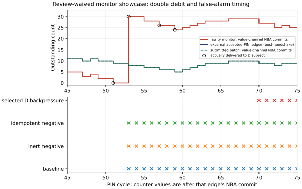

# Completed review-waived TileLink showcases

The user explicitly instructed: "this is for showcases. skip human review". This cohort contains 14 mechanically admitted synthetic cases × A/B/C/D × one repetition, 56 scheduled subjects. It is a descriptive showcase cohort, not the unused 168-session independent primary comparison. No human reviewer, expert mechanism/prediction score, novelty certification or causal-effectiveness estimate is asserted.

Every cell starts a fresh Python process, Codex subprocess and thread. The original freeze remains unchanged; a separate four-file sealed overlay records the user-authorized scope. Authentication remains ChatGPT sign-in with exact `gpt-6.1-sol`/`medium`; case-only tools, empty workspaces, source-hidden seals with issued evidence IDs, prewritten D predictions, actual force/release plus two negatives and the three admitted grading schedules remain enforced. Provider cache reads are permitted telemetry; unknown values remain unknown.

| Mode | Fault subjects | Verified repairs | Clean subjects | Verified no-edit clean | Other recorded outcomes | Median model/tool wall, s | Median full cell wall, s | Reported input / output / cached input tokens |
|---|---:|---:|---:|---:|---:|---:|---:|---|
| A | 12 | 12 | 2 | 2 | 0 | 59.33 | 67.88 | 3,869,497 / 20,383 / 3,361,792 |
| B | 12 | 12 | 2 | 2 | 0 | 46.26 | 54.83 | 3,767,508 / 15,963 / 3,258,880 |
| C | 12 | 12 | 2 | 2 | 0 | 45.57 | 54.14 | 4,429,668 / 16,238 / 3,786,368 |
| D | 12 | 12 | 2 | 2 | 0 | 49.50 | 57.92 | 4,202,261 / 18,597 / 3,667,200 |

Input totals include cached input; do not add cached tokens again. Model/tool wall is the subject receipt interval; full cell wall also includes host authorization, fresh-process startup and separate grading. Shared native/value/VCD preparation and post-submission reference replay are separate. Dollar allocation and remote inference hardware/RSS are unknown. Subscription authentication does not guarantee zero cache, erase pretraining or pin immutable model weights.

| Mode | Returned tool text, bytes | Actual native-query subjects | Qualifying intervention subjects | Physical experiments / mechanical passes | D simulator invocations / wall, s | Grading invocations / simulator wall, s |
|---|---:|---:|---:|---|---|---|
| A | 558,183 | 0 | 0 | 0 / 0 | 0 / 0.000 | 48 / 0.863 |
| B | 573,035 | 0 | 0 | 0 / 0 | 0 / 0.000 | 48 / 0.867 |
| C | 846,139 | 14 | 0 | 0 / 0 | 0 / 0.000 | 48 / 0.866 |
| D | 770,669 | 14 | 14 | 15 / 15 | 60 / 0.997 | 48 / 0.869 |

Token telemetry unknown in 0 subjects; cached-input telemetry unknown in 0. A mechanical experiment pass is not a semantic prediction score. A source-revealed repair is not a source-hidden mechanism grade. No C−B/D−C accuracy effect, confidence interval, statistical equivalence or incremental native benefit is inferred.

## Every recorded nonverified outcome

All recorded subjects received a runtime-verified repair or clean confirmation. This does not establish source-hidden diagnosis correctness.

All failed physical experiments, if any, remain in the per-subject receipts even when a later allowed selection qualified. Both negatives were independently executed for each physical request. No prior case output or model session was resumed.

## Selected independently replayed cases

Selection rule: the first sorted completed and runtime-verified D fault per component. This selects executable showcase examples, not a random efficacy sample. All cohort failures above remain in the denominator. Runtime verification used the separately pinned reference simulator; no human expert score is implied.

### endpoint: `case_2248fbe7ddf3b974`

StageI seal: `020d3c3e5cacb86650a59d3fe6c633e3846713f66f64519e4f70e54c572f830e`. The following mechanism is the actual pre-source model submission; uncertainty and incomplete localization are retained.

> Some reads return zero where accepted-request reference memory requires 2436350380. Extending D backpressure preserves the source-9 mismatch and all 65 issues while shifting their timing, supporting corruption before D retirement. The exact internal cause remains unresolved; native samples provide no writer provenance.

Registered action: `response_backpressure`, negedge counter 73, duration 8. Prediction written before execution:

> Hold D acceptance across the baseline source-9 read response at cycle 76. If the zero read value originates in write storage or the read snapshot, accepted read-data mismatches should persist after release, although cycles may shift. If it originates in D retirement/reuse or a response correlation race, the mismatch pattern may change or disappear. Both the inert-wire and idempotent request-throttle-zero controls should reproduce baseline traffic and diagnostics.

Actual mechanical status: PASS; force/release markers: True; both negatives match baseline: True.

| Actual run | Independent oracle | Issue count | First issues |
|---|---|---:|---|
| baseline | FAIL | 65 | [{"cycle":76,"kind":"read_data_mismatch","source":9,"expected_data":2436350380,"observed_data":0,"request":22},{"cycle":81,"kind":"read_data_mismatch","source":0,"expected_data":2436350380,"observed_data":0,"request":23},{"cycle":96,"kind":"read_data_mismatch","source":7,"expected_data":2436350380,"observed_data":0,"request":24}] |
| experiment | FAIL | 65 | [{"cycle":94,"kind":"read_data_mismatch","source":9,"expected_data":2436350380,"observed_data":0,"request":22},{"cycle":96,"kind":"read_data_mismatch","source":10,"expected_data":2436350380,"observed_data":0,"request":29},{"cycle":98,"kind":"read_data_mismatch","source":11,"expected_data":2436350380,"observed_data":0,"request":20}] |
| unrelated | FAIL | 65 | [{"cycle":76,"kind":"read_data_mismatch","source":9,"expected_data":2436350380,"observed_data":0,"request":22},{"cycle":81,"kind":"read_data_mismatch","source":0,"expected_data":2436350380,"observed_data":0,"request":23},{"cycle":96,"kind":"read_data_mismatch","source":7,"expected_data":2436350380,"observed_data":0,"request":24}] |
| idempotent | FAIL | 65 | [{"cycle":76,"kind":"read_data_mismatch","source":9,"expected_data":2436350380,"observed_data":0,"request":22},{"cycle":81,"kind":"read_data_mismatch","source":0,"expected_data":2436350380,"observed_data":0,"request":23},{"cycle":96,"kind":"read_data_mismatch","source":7,"expected_data":2436350380,"observed_data":0,"request":24}] |

Counter timing is the actual negedge counter, not an asserted PIN-cycle interval. Counts and timing shifts do not themselves prove a unique internal cause or repair.

Actual StageII submission after the seal:

```diff
-            if(pending_write_count<4) begin
-              memory[word_index] <= write_word;
-              memory_parity[word_index] <= ^write_word;
-            end
+            memory[word_index] <= write_word;
+            memory_parity[word_index] <= ^write_word;
```

Patched source SHA256: `2e796ae7eb0259d69826b04fb6bb416c964a607cc2bd985100aebec02f30e2a7`. All three reference schedules pass and match the research grading traces; every registered four-run faulty experiment also replays with matching public traces. 1 registered experiment(s) replayed. Human mechanism/prediction and patch-semantic scores were not assigned under the user-authorized showcase waiver.

### monitor: `case_52507cae2630a60c`

StageI seal: `a5212f5a91b31fad033f296cee0627f11b0d6be55607253447b45e875aa7d498`. The following mechanism is the actual pre-source model submission; uncertainty and incomplete localization are retained.

> A single accepted D response can decrement pending_count by two while clearing only one pending source bit. At cycle 51 the count falls from 2 to 0; at cycle 53, the valid retirement of source 6 wraps it from 0 to 30 and source_alarm asserts. The evidence supports timing-dependent duplicate retirement accounting; the exact source expression remains unavailable.

Registered action: `response_backpressure`, negedge counter 49, duration 8. Prediction written before execution:

> The monitor appears to double-decrement pending_count on responses first observed with ready high. Forcing D backpressure near baseline source-4/source-5 completion should delay retirement and change the count/alarm trajectory (first alarm later than cycle 53), while accepted PIN traffic remains protocol-correct. Inert-wire and request-throttle-zero controls should preserve baseline first alarm at 53. A genuine orphan source would remain an independent PIN violation despite the timing change.

Actual mechanical status: PASS; force/release markers: True; both negatives match baseline: True.

| Actual run | Independent oracle | Issue count | First issues |
|---|---|---:|---|
| baseline | FAIL | 326 | [{"kind":"monitor_false_alarm","cycle":53,"component":"source_alarm","observed_alarm":1},{"kind":"monitor_false_alarm","cycle":54,"component":"source_alarm","observed_alarm":1},{"kind":"monitor_false_alarm","cycle":55,"component":"source_alarm","observed_alarm":1}] |
| experiment | FAIL | 281 | [{"kind":"monitor_false_alarm","cycle":70,"component":"source_alarm","observed_alarm":1},{"kind":"monitor_false_alarm","cycle":71,"component":"source_alarm","observed_alarm":1},{"kind":"monitor_false_alarm","cycle":72,"component":"source_alarm","observed_alarm":1}] |
| unrelated | FAIL | 326 | [{"kind":"monitor_false_alarm","cycle":53,"component":"source_alarm","observed_alarm":1},{"kind":"monitor_false_alarm","cycle":54,"component":"source_alarm","observed_alarm":1},{"kind":"monitor_false_alarm","cycle":55,"component":"source_alarm","observed_alarm":1}] |
| idempotent | FAIL | 326 | [{"kind":"monitor_false_alarm","cycle":53,"component":"source_alarm","observed_alarm":1},{"kind":"monitor_false_alarm","cycle":54,"component":"source_alarm","observed_alarm":1},{"kind":"monitor_false_alarm","cycle":55,"component":"source_alarm","observed_alarm":1}] |

Counter timing is the actual negedge counter, not an asserted PIN-cycle interval. Counts and timing shifts do not themselves prove a unique internal cause or repair.

Actual StageII submission after the seal:

```diff
-delta=(av&&ar?1:0)-(dv&&dr?2:0);
+delta=(av&&ar?1:0)-(dv&&dr?1:0);
```

Patched source SHA256: `bd5e414bc06b7a798a6e4553c59946055b46a16173ae84d9407a62ea3e301418`. All three reference schedules pass and match the research grading traces; every registered four-run faulty experiment also replays with matching public traces. 1 registered experiment(s) replayed. Human mechanism/prediction and patch-semantic scores were not assigned under the user-authorized showcase waiver.



Value-channel NBA commits are compared with an external accepted-PIN ledger. Circles mark values actually delivered to the D subject; other line points are trusted-log context. These late counter values are not native observations. D received native context at 225000–265000ps, outside the plotted late counter window. The registered experiment moved the first alarm from 53 to 70; both negative controls retain 53. [Vector PDF](figures/review_waived_monitor.pdf), [source data and hashes](figures/review_waived_monitor_data.json).

### scoreboard: `case_7d2add13c79822d8`

StageI seal: `e74218e255db647b95fad0356642870ee9ce6b41fa75a96897e45929902dbf6e`. The following mechanism is the actual pre-source model submission; uncertainty and incomplete localization are retained.

> Source 4 snapshots the correct expected value 0x91374e3e at A acceptance and returns that same value at cycle 72, yet data_alarm asserts. This indicates subsequent expectation corruption or incorrect response-to-expectation selection. History cursor activity suggests bounded-history bookkeeping as a candidate, but the exact mechanism remains unresolved.

Registered action: `response_backpressure`, negedge counter 70, duration 10. Prediction written before execution:

> The source-4 read at baseline cycle 72 returns the correct previously accepted write value 2436320830, so suspect the shadow scoreboard expectation/correlation rather than endpoint data. Forcing response backpressure across this response should preserve its payload and defer a handshake-gated false data alarm until D acceptance; an alarm while stalled instead indicates valid-only comparison. Inert-wire and request-throttle-zero controls should retain the baseline cycle-72 false alarm and accepted traffic.

Actual mechanical status: PASS; force/release markers: True; both negatives match baseline: True.

| Actual run | Independent oracle | Issue count | First issues |
|---|---|---:|---|
| baseline | FAIL | 57 | [{"kind":"monitor_false_alarm","cycle":72,"component":"data_alarm","observed_alarm":1},{"kind":"monitor_false_alarm","cycle":80,"component":"data_alarm","observed_alarm":1},{"kind":"monitor_false_alarm","cycle":82,"component":"data_alarm","observed_alarm":1}] |
| experiment | FAIL | 58 | [{"kind":"monitor_false_alarm","cycle":81,"component":"data_alarm","observed_alarm":1},{"kind":"monitor_false_alarm","cycle":100,"component":"data_alarm","observed_alarm":1},{"kind":"monitor_false_alarm","cycle":102,"component":"data_alarm","observed_alarm":1}] |
| unrelated | FAIL | 57 | [{"kind":"monitor_false_alarm","cycle":72,"component":"data_alarm","observed_alarm":1},{"kind":"monitor_false_alarm","cycle":80,"component":"data_alarm","observed_alarm":1},{"kind":"monitor_false_alarm","cycle":82,"component":"data_alarm","observed_alarm":1}] |
| idempotent | FAIL | 57 | [{"kind":"monitor_false_alarm","cycle":72,"component":"data_alarm","observed_alarm":1},{"kind":"monitor_false_alarm","cycle":80,"component":"data_alarm","observed_alarm":1},{"kind":"monitor_false_alarm","cycle":82,"component":"data_alarm","observed_alarm":1}] |

Counter timing is the actual negedge counter, not an asserted PIN-cycle interval. Counts and timing shifts do not themselves prove a unique internal cause or repair.

Actual StageII submission after the seal:

```diff
-   if(pending_history_valid[pending_history_cursor]) pending_expected[pending_history_source[pending_history_cursor]]<=0;
```

Patched source SHA256: `bd5e414bc06b7a798a6e4553c59946055b46a16173ae84d9407a62ea3e301418`. All three reference schedules pass and match the research grading traces; every registered four-run faulty experiment also replays with matching public traces. 1 registered experiment(s) replayed. Human mechanism/prediction and patch-semantic scores were not assigned under the user-authorized showcase waiver.

## Reproducibility and limits

The initial 52 strict pilot subjects and 20 excluded stock-runner development subjects remain separate. This user-amended cohort reuses the mechanically admitted catalog as showcases and retires it from the unused primary controller. One repetition, a synthetic endpoint/common checker architecture, shared traffic and unresolved semantic novelty/identifiability limit generalization. The fixed early native window may miss late causes; unavailable writer/source provenance remains null. Mandatory native queries test prescribed use, not spontaneous adoption.

[All 56 subject outcomes and costs](receipts/review_waived_showcases.json), [selected exact submissions and predictions](receipts/review_waived_selected_cases.json), [reference replay receipts](receipts/review_waived_showcase_verification.json), [user scope amendment](receipts/showcase_user_scope_amendment.json), [sealed overlay](receipts/showcase_overlay_seal.json). Full transcripts and private catalog keys remain outside the public paper artifacts. The accepted abstract and earlier studies were not edited.

Two post-run engineering failures are preserved: verification helper 001 stopped on a Python naming collision, and report renderer 001 stopped when recopying identical readonly receipts. Corrected helpers used a new verification output directory and an idempotent report sync. Neither changed any model trial, submitted patch or original grade. [Post-run failure receipts](receipts/showcase_postprocessing_failures.json).
