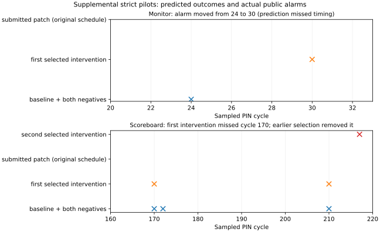

# Three recorded TileLink debugging showcases

These are selected **strict pilot** narratives from the completed 52-subject calibration, not independent holdouts or an effectiveness estimate. Every subject used a fresh subscription-authenticated Codex process/thread, `gpt-6.1-sol` / `medium`, and case-only tools. Stage I was sealed with valid issued evidence IDs before permitted source disclosure. Human mechanism/prediction grades are pending. All failures remain in the cohort ledger.

## 1. Endpoint response retirement: verified on both simulators

A source-7 WriteAck is offered while ready is low at cycle 23, then disappears without acceptance at cycle 24. A fresh C subject received native pretrigger valid transitions at 275000 and 285000 ps, before the accepted-D trigger at 295000 ps. A separate D subject used pins, value and experiment evidence to diagnose premature retirement. D queried only earlier native context; its later diagnosis cannot be credited to C's observation.

D registered a backpressure experiment before execution, with inert-net and idempotent-throttle negative controls. Actual force starts between PIN23 and PIN24 and releases between PIN31 and PIN32. The faulty response still withdraws; both negatives reproduce baseline exactly. After its Stage I seal, D added `&& d_ready` to the retirement condition. Separate grading passed three schedules. Reference replay reproduced all four faulty control traces; the exact submitted patch passed all three schedules and eight repaired control runs across both simulators. The experiment does not uniquely identify every possible internal fault.

[Full causal case and measured timeline](RESULTS_FOR_DVCON.md#a-source-hidden-causal-case), [sanitized evidence and verification receipt](receipts/strict_case02_D.json).

## 2. Monitor false alarm: a useful experiment with a wrong timing prediction

In temporal03, the endpoint keeps its source-7 response stable through the cycle-23 stall and accepts it at cycle24. The source-balance monitor instead clears its pending state on valid alone: the subject cites monitor retirement at275000ps versus endpoint retirement at285000ps. It distinguishes an erroneous monitor from an endpoint duplicate/orphan response and a possible FIFO-order assumption before seeing source.

D registered `response_backpressure`, counter23, duration6. It predicted a source alarm by cycle24 **during** the extended stall. The real experiment contradicted that timing: the first alarm moved from cycle24 to cycle30. Each negative control retained the baseline cycle24 alarm and identical public traffic. All four runs completed and each retained16 oracle issues. Mechanical experiment qualification passed; the specific registered alarm-timing prediction did not. The model acknowledged this miss in its sealed assessment and refined the explanation: pending state clears early, but alarm reporting is handshake-qualified. This refinement is post-experiment evidence, not a retroactively successful original prediction.

After sealing, the submitted monitor patch changed retirement from `if(dv)` to `if(dv&&dr)`. Original, unseen and adversarial grader schedules passed. A separate anti-silencing canary still detected a genuinely faulty endpoint (`source_alarm=1`, independent oracle FAIL as intended). Thus simply suppressing alarms was not sufficient. Post-submission reference-simulator replay of the exact patch passes all three schedules with matching public traces. All four registered faulty experiment traces also reproduce exactly.

## 3. Scoreboard read snapshots: first intervention too late, earlier selection informative

In temporal05, source15 accepts a read at address40 in cycle146. A partial write updates that address in cycle165; the original read value returns at cycle170 and triggers a shadow-scoreboard alarm. Before source disclosure, D proposes that the scoreboard compares against current memory rather than the read's accepted-A snapshot, retaining source-reuse misassociation and endpoint snapshot corruption as alternatives.

The first registered intervention throttles requests at counter165 for8 cycles and predicts removal of the cycle170 alarm. Actual readiness changes first at cycle166: the write has already been accepted. The cycle170 alarm remains. The experiment changes other public behavior and passes the mechanical contrast check, but fails its stated target prediction. There are11 issues versus12 at baseline; this is not a repair.

Within the common two-experiment allowance, D registers an earlier selection, counter163 for10 cycles. Actual readiness changes at cycle165; alarms at170 and172 disappear and the first remaining alarm is217. Ten issues remain overall. Both independent negative controls for **each** experiment reproduce the baseline12 issues, including170 and172. The second experiment supports sensitivity to the intervening write; a complete semantic discrimination grade remains pending.

After Stage I sealing, D changes the checker comparison from live `model_memory[read_address[dsrc]]` to the captured `expected[dsrc]`. Three grader schedules pass. The data-alarm canary still catches a genuine bad endpoint (`data_alarm=1`, independent oracle FAIL as intended). The independent oracle itself is protected. Post-submission reference-simulator replay of the exact patch passes all three schedules; both registered four-run faulty experiments reproduce exact public traces. The fixed early native capture did not establish coverage of the late cycle170 symptom.

Each cross marks an actual recorded alarm. Empty patch rows mean no alarm within the plotted window; three-schedule full-run grades are separate. Baseline and both negatives have identical public traces. Patches are model submissions evaluated in separate grader runs, not model-selected interventions. [Vector PDF](figures/supplemental_monitor_scoreboard.pdf), [plot data and log hashes](figures/supplemental_monitor_scoreboard_data.json), [registered predictions, observations, seals, patches and canaries](receipts/supplemental_cases.json), [independent verification](receipts/supplemental_independent.json).

## Preserved outcomes for the temporal pilot constructs

`R` means a submitted patch passed independent-oracle original/unseen/adversarial grading; `Q` means quota failure with no StageII source disclosure. Neither symbol is an expert StageI mechanism grade.

| Pilot construct | A | B | C | D |
|---|---|---|---|---|
| temporal01 | Q | Q | Q | Q |
| temporal02 | R | R | R | R |
| temporal03 | R | R | R | R |
| temporal04 | R | R | R | R |
| temporal05 | R | Q | Q | R |
| temporal06 | R | R | Q | R |
| temporal07 | R | Q | Q | Q |
| temporal08 | R | Q | Q | Q |

All20 named-case cells in the same strict schedule are R. Thirteen quota failures and the missing numeric briefing prevent interpreting these patterns as a native-tool benefit. The later common briefing correction was qualified separately and was never applied retrospectively. [All52 subjects and measured per-mode costs](receipts/strict_pilots.json).
